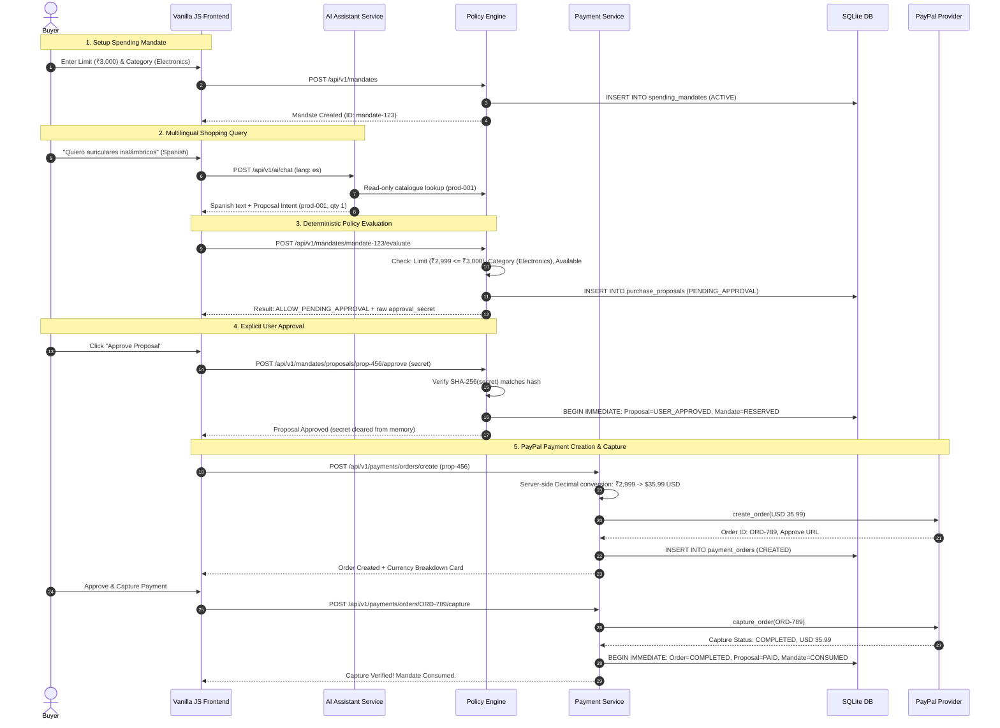
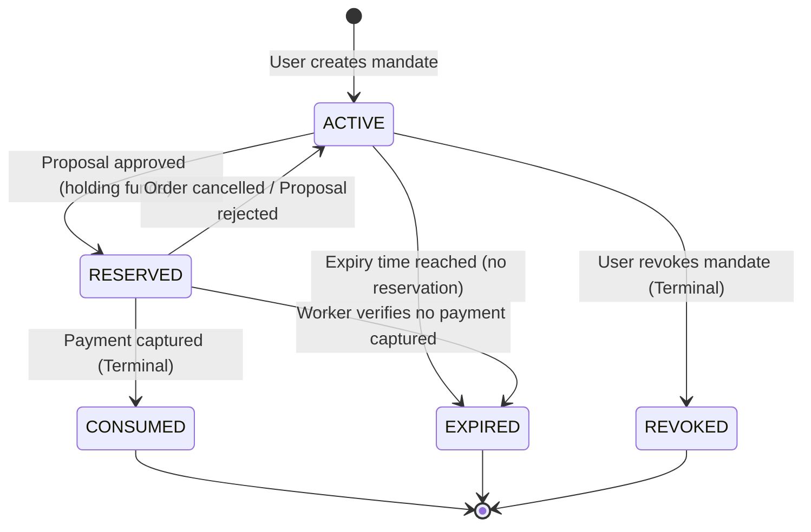
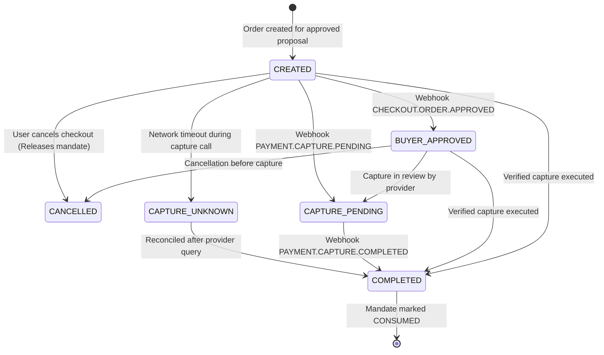

# Multilingual Safe-Checkout Helper — Architecture Specification

This document provides a comprehensive technical overview of the system architecture, component responsibilities, data flow, and security boundaries implemented in the Multilingual Safe-Checkout Helper project.

---

## 1. System Overview & Component Hierarchy

The system is organized into modular Python packages with strict layer boundaries:

```
┌────────────────────────────────────────────────────────────────────────┐
│                        Vanilla JS Frontend (SPA)                       │
│  - Catalogue Browser  - Spending Mandates  - AI Chat  - PayPal Bridge │
└────────────────────────────────────┬───────────────────────────────────┘
                                     │ JSON REST API / HTTPS
┌────────────────────────────────────▼───────────────────────────────────┐
│                          FastAPI Web Application                       │
│                                                                        │
│  ┌────────────────┐  ┌────────────────┐  ┌───────────────────────────┐ │
│  │ Catalogue API  │  │ AI Assistant   │  │ Policy Engine             │ │
│  │ (/products)    │  │ (/ai/chat)     │  │ (/mandates)               │ │
│  └───────┬────────┘  └───────┬────────┘  └─────────────┬─────────────┘ │
│          │                   │ (Read-only tools)       │               │
│          ▼                   ▼                         ▼               │
│  ┌───────────────────────────────────────────────────────────────────┐ │
│  │                   Authoritative Catalogue & Policy                │ │
│  └───────────────────────────────────┬───────────────────────────────┘ │
│                                      │                                 │
│                                      ▼                                 │
│  ┌───────────────────────────────────────────────────────────────────┐ │
│  │                      PayPal Payment Service                       │ │
│  │    - Order Creation   - Capture Verification   - Cancellation     │ │
│  │    - Webhook Signature & Replay Deduplication                     │ │
│  └───────────────────────────────────┬───────────────────────────────┘ │
│                                      │                                 │
│                                      ▼                                 │
│  ┌───────────────────────────────────────────────────────────────────┐ │
│  │              Background Expiry Reconciliation Worker              │ │
│  └───────────────────────────────────┬───────────────────────────────┘ │
└──────────────────────────────────────┼─────────────────────────────────┘
                                       │ WAL mode & BEGIN IMMEDIATE
┌──────────────────────────────────────▼─────────────────────────────────┐
│                     Durable SQLite Database Engine                     │
│   spending_mandates │ purchase_proposals │ payment_orders │ webhooks   │
└────────────────────────────────────────────────────────────────────────┘
```

---

## 2. Component Responsibilities & Boundaries

### 2.1 Frontend (Single-Page Vanilla JS Application)
- **Files:** `frontend/index.html`, `frontend/css/style.css`, `frontend/js/main.js`.
- **Responsibilities:**
  - Renders product catalogue, mandate creation, AI chat dialogue, and payment controls.
  - Formats user input and displays localized responses in English, Spanish, and French.
  - Maintains the temporary cryptographic `approval_secret` **strictly in private closure memory**. The secret is never written to `localStorage`, `sessionStorage`, DOM attributes, or query parameters, and is zeroed immediately upon use.
  - Enforces UI duplicate-request disabling on action buttons.

### 2.2 Product Catalogue Service
- **Files:** `app/catalogue/models.py`, `app/catalogue/repository.py`, `app/catalogue/service.py`, `app/catalogue/router.py`.
- **Responsibilities:**
  - Maintains 10 seeded demonstration products priced authoritatively in Indian Rupees (`INR`).
  - Represents all prices with Python `Decimal` with strict two-decimal validation (`quantize(Decimal("0.01"))`).
  - Read-only data access; products cannot be modified or price-altered by API clients or AI assistants.

### 2.3 Multilingual AI Assistant Service
- **Files:** `app/ai/models.py`, `app/ai/prompts.py`, `app/ai/tools.py`, `app/ai/service.py`, `app/ai/router.py`.
- **Responsibilities:**
  - Translates and explains products in English, Spanish, and French.
  - Interacts with catalogue via **strictly read-only tools** (`list_catalogue_categories`, `search_catalogue_products`, `get_catalogue_product_details`).
  - Can generate a purchase proposal intent specifying only `product_id` and `quantity`.
  - **Hard Security Boundary:** The AI prompt and Pydantic schemas explicitly forbid the assistant from calculating prices, currencies, discounts, or authorizing payments. Any AI-suggested prices are rejected by the backend.

### 2.4 Deterministic Policy Engine & Mandate Repository
- **Files:** `app/policy/models.py`, `app/policy/repository.py`, `app/policy/service.py`, `app/policy/router.py`.
- **Responsibilities:**
  - Creates, validates, and persists user spending mandates in SQLite.
  - Evaluates purchase proposals deterministically against mandate constraints:
    - `max_amount` (monetary cap)
    - `permitted_categories` (whitelist)
    - `max_quantity` (item quantity cap)
    - `expires_at` (strict UTC timestamp comparison)
    - Product stock availability
  - Generates a cryptographically strong 32-byte hexadecimal `approval_secret` and stores only its SHA-256 hash in SQLite (`approval_secret_hash`).
  - Locks the mandate reservation to `RESERVED` upon explicit user approval inside a `BEGIN IMMEDIATE` transaction.

### 2.5 PayPal Payment Service & Webhook Ingestion
- **Files:** `app/payment/models.py`, `app/payment/currency.py`, `app/payment/repository.py`, `app/payment/service.py`, `app/payment/router.py`.
- **Responsibilities:**
  - Requires a verified, user-approved proposal (`USER_APPROVED`) and reserved mandate (`RESERVED`) before creating a payment order.
  - Bridges the INR catalogue price to USD using a deterministic server-side Decimal conversion at a fixed demonstration rate (`0.0120` USD per INR).
  - Interacts with PayPal via `MockPaymentProvider` (default offline mode) or `PayPalSandboxProvider` (live PayPal Sandbox REST API).
  - Verifies PayPal webhook signatures via PayPal's official endpoint `POST /v1/notifications/verify-webhook-signature`.
  - Atomically marks the order `COMPLETED`, transitions the proposal to `PAID`, and finalizes the mandate to `CONSUMED` upon verified capture.

### 2.6 Abandoned Checkout Expiry Reconciliation Worker
- **Files:** `app/payment/worker.py`.
- **Responsibilities:**
  - Periodic background task running within the FastAPI application lifespan.
  - Evaluates expired mandates holding active reservations under the **Critical Reservation Rule**: A mandate's expiry timestamp alone is never sufficient evidence to release a reservation.
  - Queries external provider order status before releasing any hold. Retains the reservation if capture is pending, approved, or if the provider is unreachable.

---

## 3. Data Flow & Sequence Diagram

The following Mermaid diagram traces a complete transaction from chat recommendation to completed payment:



---

## 4. State Machines & Transitions

### 4.1 Spending Mandate Lifecycle



### 4.2 Payment Order Lifecycle



---

## 5. Persistence & Concurrency Model

- **Engine:** SQLite with Write-Ahead Logging (`PRAGMA journal_mode=WAL;`).
- **Foreign Keys:** Strictly enabled (`PRAGMA foreign_keys=ON;`).
- **Busy Timeout:** Configured to `5000ms` to accommodate serialized file locks without immediate aborts.
- **Transaction Locking:** All state mutations use `BEGIN IMMEDIATE` transactions to prevent dirty reads, competing mandate reservations, or duplicate order insertions.
- **External Calls Separation:** All outbound network operations (Gemini API calls, PayPal REST requests) are executed **strictly outside SQLite transactions**, ensuring database locks are never held across network I/O.
